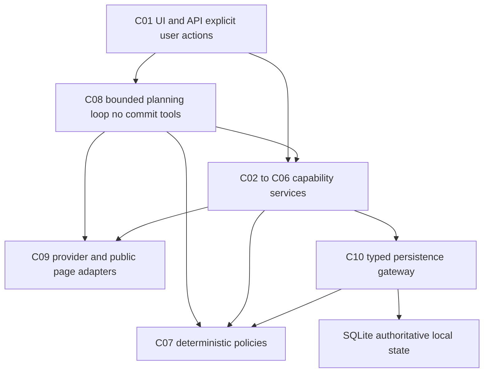

# Application Design — Consolidated

Status: Explicitly approved by the team, recorded at 2026-11-20T19:42:32Z. Documentation only; no implementation or external connection performed. Unit artifacts require separate approval.

## Decision record and reading guide

Approved plan choices A/A/A/B/A are preserved: business-capability modules, typed success/results and typed errors, dedicated planning orchestration, cohesive persistence gateway owning atomicity, bounded final-response UI. The following sections consolidate components.md, component-methods.md, services.md and component-dependency.md; those companion files remain the focused review views of the same design.

All interfaces are design notation, not implementation. No endpoint code, schema migration, provider call, source acquisition or tests are created. Logical services are not microservices; final work units/code organization remain for Units Generation after explicit artifact approval.

## Consolidated section: Component responsibilities

## Architecture decisions

Approved choices A/A/A/B/A: capability-centered modules; typed success results with typed errors; dedicated planning coordinator; cohesive persistence gateway owning atomic transactions; final-response request presentation without streaming/background jobs. These are logical components within the approved local stack, not independently deployable services. Units Generation will define work units and code organization after artifact approval.

| ID | Component | Purpose and responsibilities | State and boundaries | Story coverage |
| --- | --- | --- | --- | --- |
| C01 | Local UI/API boundary | Streamlit renders English keyboard-operable forms and waiting states; FastAPI validates typed requests and maps typed errors. Derives confirmation context from explicit user actions, never from model text. | Transient forms and request context; no direct DB/model-key access. | All US-01–US-19 |
| C02 | Preferences | Owns profile preferences, exclusions, diner count 1–10 and meal overrides; defaults 15/45/45 minutes. | Logical profile ownership; persisted through C10. | US-01 |
| C03 | Recipes | Owns catalog, provenance/completeness eligibility, local keyword/ingredient/tag retrieval, source imports and approved variants; maintains 45-record coverage assessment. | Recipe/provenance ownership; C09 handles untrusted fetch, C10 persists. | US-03–US-05, US-18 |
| C04 | Inventory | Exposes versioned stock snapshots and explicit manual add/correct/remove; never hides deduction inside a read. | Logical ingredient stock ownership; all writes through C10. | US-02, US-09, US-11–US-16 |
| C05 | Planning/Shopping | Owns plan draft/save/change/skip, annotations and shopping views; deterministic calculation delegates to C07. Agent revisions require explicit preview/confirmation. | Plan/annotation logical ownership; C10 stores saved plans; drafts are non-authoritative. | US-06–US-10, US-16–US-17 |
| C06 | Cooking Events | Owns preview/confirm/undo application workflows. Validates explicit user intent and coordinates with C10 atomic domain operations; no direct model commit path. | Preview/event lifecycle responsibility; immutable event history and compensations stored by C10. | US-11–US-15, US-17 |
| C07 | Deterministic Policies | Pure typed quantity scaling, compatible-unit conversion, shopping aggregation, exclusion/eligibility/time/repetition validation and high-level transaction/undo checks. No model/DB/network dependency. | No persistent state. | US-01, US-03, US-06–US-09, US-11–US-15, US-18 |
| C08 | Planning Orchestrator | Dedicated bounded model/tool loop for planning and remaining-meal revision. Dispatches allowlisted reads and validation; returns validated proposals, never persists user domain changes. | Ephemeral run state and redacted diagnostic traces, not user confirmation authority. | US-06–US-07, US-16, US-19 |
| C09 | External Adapters | Separate provider adapter for native function calling and recipe-page adapter for bounded public HTTP(S)/JSON-LD parsing. No source terms or model availability assumed verified. | Secrets server-side; fetched content is untrusted data. | US-04–US-05, US-19 |
| C10 | Persistence Gateway | Owns SQLite access and typed domain persistence operations. Atomic confirm/undo couples stock, events, version and idempotency records with rollback. No arbitrary SQL interface exposed to other components. | Physical persistence ownership for profile, recipes, stock, plans, previews, events and request outcomes. | All persistent stories, especially US-12–US-15 |

## Ownership rules

Application services own user intent and use-case coordination; C10 owns persistence/transaction mechanics; C07 owns deterministic policies. “Owns” does not grant an agent permission to write. C01 routes confirmed commands to C02–C06; C08 may read those capabilities and validate proposals but cannot invoke commit/save/undo tools.

C03 publishes eligible recipe records, not raw page instructions. All automatic plans and cooking previews use reviewed complete records. C04 publishes snapshots; no other component independently adjusts stock. C05 can change a plan or annotate takeout/leftovers without consuming ingredients. C06 commits actual cooking once, with explicit confirmation; the amount cooked, not the fraction immediately eaten, determines consumption. C10 alone mutates stock/version/event/idempotency state atomically.

External provider access remains Gemini Developer API gemini-3.5-flash-lite, free-tier only and unverified until later Construction. No general web search, new model fallback, paid service, login, concurrent editing, cloud deployment or leftover portion inventory is introduced.

## Public interfaces

Every component's interface is specified in component-methods.md. Application orchestration is in services.md; allowed calls and trust boundaries are in component-dependency.md. All 19 stories and 33 requirement identifiers are mapped in application-design.md. No omitted UI capability is delegated to an unconstrained chat prompt.

## Consolidated section: Interfaces and contracts

## Contract conventions

Signatures below are design notation, not executable application code. Inputs/outputs are named domain contracts. Successful methods return the named typed result; documented typed exceptions propagate to one central C01 API mapper or C08 tool mapper. Model outputs/tool arguments remain untrusted and require validation.

| Type | High-level fields and meaning |
| --- | --- |
| Quantity | Finite nonnegative decimal amount and explicit unit: g/kg, ml/l or count; no density/count-weight assumptions. |
| Preferences / MealOverride | Exclusions, preferences, diner count integer 1–10, 15/45/45-minute defaults and per-meal overrides; no per-person appetite model. |
| RecipeRecord / RecipeCandidate | Stable ID, title, ingredient quantities/units, base servings, instructions, time estimate, meal/cuisine tags, provenance, retrieval date, completeness/review/eligibility status. |
| RecipeQuery / CoverageReport | Keyword/ingredient/tag criteria; count of eligible complete distinct recipes and coverage/shortfall information. |
| InventorySnapshot | Ingredient quantities and inventory version; read result, not a stock reservation. |
| PlanDraft / ValidatedPlan | Five-day 15-slot proposal, dishes, scaled quantities, constraint decisions/permissions, recipe references and validation report; may expose shortages. |
| ShoppingList | Aggregate compatible requirements, inventory credited once, nonnegative shortages and incompatible-unit findings. |
| ProposalRef / ConfirmationContext | Server-recognized proposal identity/revision and payload binding; explicit user-action origin, action type and scope. Model-supplied booleans cannot manufacture confirmation. No login/auth feature implied. |
| ConsumptionPreview | Preview identity, selected recipe revision, servings/actual quantities, expected inventory version, deductions/shortages, prospective stock and validation results; preview is not a committed event. |
| CookingResult / UndoResult | Recorded event/compensation identity, resulting stock/version and request identifier; replay returns the recorded outcome. |
| ErrorDetails | Stable category, safe user message, relevant field/conflict/shortage details, recovery action and trace correlation; no API key or hidden prompt leakage. |
| PlanningTrace | Redacted tool names, validated arguments/results, deterministic validation and revision/failure steps; diagnostic data, never write authorization. |

## Interface inventory

| Owner | Signature | Purpose / contract boundary |
| --- | --- | --- |
| C01 | handle(request: ValidatedRequest, user_action: UserActionContext) -> ApiResponse | Validate request and derive action-specific confirmation context; map typed exceptions centrally; final result only. |
| C01 | render(result: ApiResponse) -> ViewState | Show editable previews, errors and waiting/final states in English; no DB or SDK access. |
| C02 | read_preferences() -> Preferences | Return single local profile. |
| C02 | save_preferences(change: PreferencesChange, intent: ManualSave) -> Preferences | Validate diner/time fields and explicit save; C10 persists. |
| C03 | search(query: RecipeQuery) -> RecipeCandidates | Local filters/ranking; candidates passed to automatic planning must be eligible. |
| C03 | get_recipe(id: RecipeId) -> RecipeRecord | Return record and eligibility/provenance metadata; not-found is explicit. |
| C03 | assess_coverage() -> CoverageReport | Count at least 45 distinct eligible complete recipes, Chinese/Western and all meal types; report deficits, not invented content. |
| C03 | preview_import(source: PublicUrlOrPastedText) -> RecipeImportPreview | Use C09 fetch/parser for URLs; label pasted text; return missing/eligibility findings without saving. |
| C03 | save_reviewed_recipe(preview: ProposalRef, corrections: RecipeCorrections, consent: ConfirmationContext) -> RecipeRecord | Validate completeness, provenance/use eligibility and confirmation; save via C10. Incomplete/unreviewed records cannot enter automatic use. |
| C03 | preview_variant(base: RecipeId, change: Substitution) -> RecipeVariantPreview | Preserve source lineage; no implicit conversion or approval. |
| C03 | approve_variant(preview: ProposalRef, consent: ConfirmationContext) -> RecipeRecord | Revalidate full variant and exclusions before eligible use; persist only on explicit approval. |
| C04 | snapshot() -> InventorySnapshot | Read stock with version, no mutation. |
| C04 | edit_stock(change: StockEdit, intent: ManualSave) -> InventorySnapshot | Validate nonnegative finite quantities and explicit manual action; persist/version via C10. |
| C05 | preview_change(plan: PlanRef, change: MealChange) -> PlanDraft | Replace/skip/adjust servings or annotate; no auto-save/deduction. |
| C05 | save_plan(draft: ProposalRef, consent: SaveIntent) -> SavedPlan | SaveIntent is direct manual save or explicit confirmation bound to an agent proposal; revalidate before persistence. |
| C05 | shopping(plan: PlanDraftOrSavedRef, stock: InventorySnapshot) -> ShoppingList | C07 aggregates and credits stock once; read-only. |
| C05 | save_annotation(plan: PlanRef, annotation: TakeoutOrLeftovers, intent: ManualSave) -> SavedPlan | Annotation only; no leftover portion account or raw ingredient deduction. |
| C06 | preview_consumption(selection: RecipeSelection, servings: ServingCount, actual: QuantityEdits) -> ConsumptionPreview | Check eligible recipe/units; use current stock; no stock/event commit. |
| C06 | confirm(preview: PreviewRef, consent: ConfirmationContext, request_id: RequestId) -> CookingResult | Validate explicit user action; call C10 atomic operation; no model path. |
| C06 | preview_undo(event: CookingEventId) -> UndoPreview | Read history/current stock and explain proposed compensation; no mutation. |
| C06 | confirm_undo(preview: ProposalRef, consent: ConfirmationContext, request_id: RequestId) -> UndoResult | Explicit safe once-only compensation via C10; preserve original history. |
| C07 | scale(recipe: EligibleRecipe, servings: ServingCount) -> IngredientRequirements | Deterministic arithmetic; approved units only. |
| C07 | aggregate(requirements: IngredientRequirements, stock: InventorySnapshot) -> ShoppingList | Sum compatible units, subtract stock once, floor shortages at zero. |
| C07 | validate_plan(draft: PlanDraft, profile: Preferences, permissions: RelaxationPermissions) -> PlanValidation | Exclusions hard; time/repetition exceptions only with explicit bounded permission; validate recipe eligibility and meal structure. |
| C07 | validate_consumption(preview: ConsumptionPreview, current: InventorySnapshot) -> ConsumptionValidation | Current version, sufficient nonnegative quantities and recipe integrity; authoritative validation participates in C10 transaction. |
| C07 | validate_undo(event: CookingEvent, current: InventorySnapshot, history: EventHistory) -> UndoValidation | Define safe/once-only high-level checks; detailed safe-undo policy/algorithm is a future Functional Design task. |
| C08 | propose(request: MealPlanningRequest) -> PlanningProposal | Bounded tool loop using C02–C05/C07/C09; validated draft plus trace, no persistent domain writes. |
| C08 | revise_remaining(plan: PlanRef, inventory_version: Version) -> PlanningProposal | Read latest saved plan/stock, detect impacts and propose changes; saving remains separate C05 action. |
| C08 | dispatch_tool(call: ModelToolCall) -> ToolResult | Allowlist and typed argument validation; only exposed read/compute tools, no commits. |
| C09 provider | next_turn(context: RetrievedContext, tools: ToolSchemas, deadline: Deadline) -> ModelTurn | Native function-call/text response; bounded free-tier provider call only after future access verification. |
| C09 recipe | fetch_parse(url: PublicUrl, limits: FetchLimits) -> UntrustedRecipeDocument | Validate public destination/redirects, size/time and supported source; parse JSON-LD when available, no arbitrary execution. |
| C10 | read_profile() -> Preferences; read_stock() -> InventorySnapshot; read_plan(ref: PlanRef) -> SavedPlan; read_recipe(id: RecipeId) -> RecipeRecord | Typed persistence reads; add catalog/history reads as required by C03/C06 without exposing SQL. |
| C10 | save_profile(command: ValidatedProfileWrite) -> Preferences; save_recipe(command: ValidatedRecipeWrite) -> RecipeRecord; save_plan(command: ValidatedPlanWrite) -> SavedPlan | Only application services pass backend-authorized validated commands; raw model arguments are not valid commands. |
| C10 | apply_stock_edit(command: ValidatedStockEdit) -> InventorySnapshot | Manual edit changes stock/version consistently; cannot forge cooking history. |
| C10 | store_preview(preview: ValidatedPreview) -> PreviewRef; read_preview(ref: PreviewRef) -> ConsumptionPreview | Technical preview-state storage never commits cooking or stock; binds later confirmation to reviewed content. |
| C10 | atomic_confirm(command: AuthorizedCookingCommand) -> CookingResult | Recheck bound preview/current authoritative data inside transaction; couple stock, event, version and idempotency outcome; all-or-nothing. |
| C10 | atomic_undo(command: AuthorizedUndoCommand) -> UndoResult | Recheck original event, current state and already-undone status within transaction; atomically append compensation and record outcome. |
| C10 | lookup_outcome(request_id: RequestId) -> RecordedOutcome | Recover uncertain final responses and replay same confirmed command without duplicate effects. |

## Typed failure semantics

| Category | Behavior |
| --- | --- |
| ValidationError / NotFoundError | Reject invalid input/missing reference; explain field or resource; no partial writes. |
| UnsupportedSourceError / RecipeEligibilityError | Reject unsupported/unsafe URLs or ineligible/incomplete records; offer permitted source-text correction when appropriate. |
| InfeasiblePlanError | Explain validated constraints/candidate shortage; may suggest user-approved soft relaxation, never exclusion bypass. |
| StaleStockError / InsufficientStockError | Reject cooking commit, show latest mismatch/shortage and require correction plus a fresh preview. |
| ConfirmationRequiredError / ConflictingRequestError | Reject absent/mismatched explicit intent or request-ID reuse for a different payload/action. Successful identical replay returns original typed success. |
| UnsafeUndoError / AlreadyUndoneError | No second compensation or history deletion; return safe recorded outcome for identical successful request replay. |
| ProviderUnavailableError / ToolFailureError / TimeoutError | Report failure with bounded user-controlled recovery; no false success, paid fallback or indefinite retry. |

HTTP status values, exact schemas, preview lifetime, duplicate-key storage, decimal precision, undo conflict rules and loop/fetch caps are deferred detailed-design decisions. Categories and invariants are fixed here; all numeric caps must preserve the existing 60-second model limit and approved usability targets. No new user/product decisions are silently substituted for approved requirements.

## Consolidated section: Service coordination

## Service map

| Service role | Component | Coordinates | Does not authorize |
| --- | --- | --- | --- |
| Profile application service | C02 | Read/save preferences and overrides through C07/C10 | Extra profiles, login or model writes |
| Recipe application service | C03 | Search, import preview, missing-data correction, reviewed save/variant approval through C09/C07/C10 | General web search, fabricated provenance, unconfirmed agent saves |
| Inventory application service | C04 | Versioned snapshots and explicit manual edits through C07/C10 | Implicit consumption during planning |
| Plan/shopping application service | C05 | Draft change, explicit save, annotations and deterministic shopping via C07/C10 | Raw-stock deduction or automatic revision save |
| Cooking application service | C06 | Preview, explicit confirmation, undo; calls C10 atomic operations | Model-generated permission or direct SQLite access |
| Planning orchestration service | C08 | Bounded model loop, eligible retrieval, stock/preferences reads and deterministic validation | Save, deduction, undo or external-source permission approval |
| Persistence gateway | C10 | Typed reads/writes and atomic stock/event/request outcomes | Unvalidated model or UI direct write paths |

All service names describe logical application roles, not network-deployed services.

## Planning and revision flow

1. C01 validates the user request and calls C08. C08 reads C02 preferences and C04 stock; C03 retrieves eligible attributed candidates with C07 filters. Model context includes selected recipe source content, not a claim of model-internal recipe verification.
2. C08 invokes the C09 provider adapter with typed tool schemas, request deadline and selected context. Model tool requests are untrusted. C08 checks names/arguments before calling deterministic read/compute interfaces.
3. Exposed tool capabilities: read preferences, read inventory, retrieve/get eligible recipes, scale dishes, aggregate shopping requirements and validate proposed plans. Invalid calls return typed tool failures. There is no save/commit/undo/import-write tool in this planning allowlist. A suggested public URL can be handed back for the separate recipe workflow; it is not automatically fetched or persisted by model authority.
4. C07 validates 15 slots, eligibility, diner bounds, exclusions, time and repetition rules. Tool results feed subsequent bounded revision when needed. If infeasible, report it or ask for a specific soft relaxation; no silent exception. Transport/system/tool prompts cannot count as user permission.
5. C08 returns a validated proposal, warnings/shortages and a redacted trace. C05 saves only after explicit user action bound to the proposal. C08 itself performs no persistent user-domain write.
6. After confirmed cooking/undo/manual stock changes, C08 may re-evaluate remaining meals using current stock. It returns a new proposal; C05 does not overwrite saved meals until confirmed. Saved data can be read again on subsequent user actions; no background worker is introduced.

## Recipe import and variant flow

C01 sends a requested public URL or pasted source text to C03. C09 validates supported/public destinations and bounded fetches/parsing; text remains untrusted. C03 checks provenance/use eligibility, required fields, units/base servings and review status. Missing information is displayed, not invented. Confirmed corrected complete records are saved by C10; incomplete/unreviewed records are excluded from automatic use. Substitution variants preserve source lineage, require explicit review/approval and fresh exclusion/quantity checks. The 45 eligible-record floor and Chinese/Western/all-meal coverage are reported, not claimed already achieved. Dataset acquisition and source-use checks happen in later Construction.

## Cooking preview and commit flow

C06 accepts an eligible recipe from library or plan, serving count and corrected actual use. It obtains current C04 snapshot and C07 validation and returns quantities, shortages and prospective balances. Creating technical preview state through C10 must not change inventory or record completed cooking. Cancel/view is non-consuming. Confirmation is a separate C01 user action bound to preview identity, revision/content, expected inventory version and request identifier.

C06 checks that action context and passes an authorized typed command to C10. C10's atomic transaction first handles identical recorded replay or conflicting identifier reuse, resolves the reviewed preview and current authoritative state, and revalidates version/stock/recipe data using deterministic policies. A stale or insufficient preview produces no deduction. Success commits stock, cooking event, version and idempotent outcome together; failure rolls back all partial effects. A UI click alone cannot override invalid stock, and a model message cannot create a confirmation context.

If an HTTP response is lost, display an uncertain result rather than a success claim; look up/replay the same authorized request identifier to retrieve the recorded outcome. Do not issue a fresh identifier blindly and thereby create a duplicate event. Exact implementation details belong to Functional Design/Construction.

## Undo and failure recovery

C06 reads the original event/current state, presents compensation and requires explicit confirmation. C10 checks current safety and whether the event was already undone, atomically restores the valid quantities and appends a compensation with recorded request outcome. No original event deletion or second restoration. Unsafe requests fail without mutation; precise later-change safety predicates are deferred to Functional Design rather than guessed as new product scope.

For stale/insufficient stock, the user corrects manual stock or actual quantities and requests a fresh preview before a new valid confirmation. Manual direct Save/Add/Edit/Delete confirms only that manual edit. Takeout/leftover annotations persist via C05 without raw-stock effects; original cooking is deducted once.

## Presentation and bounded errors

C01 shows a waiting state and final typed result/error; no token/status streaming or background jobs. Model requests terminate within 60 seconds, with clear user-controlled retry; non-model local actions target 2 seconds. Errors are centrally mapped to safe messages. C08 records actual tool outcomes rather than invented success; no paid provider/search fallback or automatic billing. Diagnostic traces redact secrets and unnecessary user data. Future evaluation inspects retrieval, inventory reads, deterministic validation and revision on 10 fixed scenarios: at least 8 valid plans/correct infeasibility outcomes; all 10 preserve exclusions/confirmation; feasible saved plan within one requested revision.

## Consolidated section: Dependency and data flows

## Allowed call/dependency matrix

Rows name callers; columns are callees. “R” is read, “C” compute/coordinated call, “W” authorized write, “A” atomic persistence, “E” bounded external adapter. Blank means no direct call. Each component's transitive capabilities remain subject to service contracts; a call permission does not bypass confirmation.

| Caller | C01 | C02 | C03 | C04 | C05 | C06 | C07 | C08 | C09 | C10 |
| --- | --- | --- | --- | --- | --- | --- | --- | --- | --- | --- |
| C01 | — | C | C | C | C | C | | C | | |
| C02 | | | | | | | C | | | R/W |
| C03 | | | | | | | C | | E | R/W |
| C04 | | | | | | | C | | | R/W |
| C05 | | R | R | R | | | C | | | R/W |
| C06 | | | R | R | | | C | | | R/A |
| C07 | | | | | | | | | | |
| C08 | | R | R | R | R | | C | | E | |
| C09 | | | | | | | | | | |
| C10 | | | | | | | C | | | |

C08's reads of C05 do not invoke its write methods; the tool allowlist is a strict subset of public component methods. C10 depends only on pure C07 checks and internal SQLite adapters, never on C06/C08; thus no transaction-orchestrator dependency cycle. C01 alone builds user-action contexts; application services validate those contexts before C10 writes. C09 adapters never mutate domain persistence. Logical module identity does not imply network boundaries.

## Data-flow overview

Text alternative: user actions enter C01; capability services C02–C06 use pure policies and typed persistence; C08 coordinates only read/compute tools and provider calls; C09 supplies untrusted external data/results; only C10 writes SQLite and its atomic operations recheck deterministic policies. No UI/model-to-SQLite path exists. The APP-to-EXT edge is recipe-service retrieval only; ORCH-to-EXT is provider invocation only.

## Data-flow contracts and trust crossings

| Flow | Input / output | Authority and mutation boundary |
| --- | --- | --- |
| Preferences/inventory edit | Explicit validated manual edit -> current profile/snapshot | Direct save confirms manual edit only; C10 persists/version-changes, never creates cooking implicitly. |
| Recipe source ingestion | Public URL/pasted text -> untrusted parsed metadata -> reviewed eligible record | Treat content as data, never instructions. Public destination/redirect/size/time guards precede fetch. Confirmation and eligibility checks precede reusable save. |
| Planning | Profile, stock snapshot, eligible source recipes -> tool results -> validated PlanDraft + trace | C08 read/compute only. Plan proposal does not reserve or consume stock and is not auto-saved. |
| Shopping | Selected dish requirements + one stock snapshot -> totals/shortages | Compatible arithmetic, inventory credited once, no persistence change. |
| Cooking preview | Recipe selection + servings + corrected actual use -> bound preview/expected stock version | No stock/event commit. Technical preview storage is not completed cooking or confirmation. |
| Cooking confirmation | Explicit user context + preview reference + request ID -> recorded result | C06 validates intent; C10 atomically revalidates and commits stock/event/version/request outcome or rolls back. |
| Undo | Original event + compensation preview + explicit user context -> compensation result | C10 preserves history, checks safe current state and once-only outcome. |
| Remaining meals | Current plan and post-change stock -> validated revision proposal | Same read-only planning loop; separate C05 confirmation required to save. |
| Takeout/leftover annotation | Explicit annotation save -> saved plan annotation | No leftover inventory, raw-stock mutation or repeated original deduction. |

## Key boundaries

- External websites and model output are untrusted; neither source text nor model arguments grant source-use permissions or user confirmation.
- User confirmation is action-specific and bound to the displayed proposal/preview, not a reusable model-authored flag. C01 and application services enforce it; the gateway rechecks authorized command/data integrity in its transaction.
- Stock/event atomicity belongs to C10. No other service has SQL or partial stock-write methods. SQLite remains local; hosted model requests do not carry keys to the UI or permit public DB exposure.
- No transaction spans a remote model/network request. External proposal generation occurs before user confirmation and before short local stock transactions; stale data is rejected at commit.
- Tool traces support future evaluation but are diagnostic only. Redact secrets; no credentials/audit prompt data sent automatically to providers.
- The communication contract is bounded final response. Interrupted transport gives uncertain outcome; request lookup/replay resolves it without a second deduction.

## Future verification responsibilities

Cross-component tests later exercise C01 confirmation to C06/C10 transaction rejection, C08 tool gating to C07, C03 ingestion to eligibility, and C05 shopping/annotations with no stock writes. Hypothesis properties cover quantity/round-trip/invariant/idempotency/stateful behavior per applicable future stages. No such tests or service access occur in this artifact stage.

## Story coverage matrix

| Story | Primary design owners | Interface / flow evidence |
| --- | --- | --- |
| US-01 | C02/C01 | read/save_preferences; validated defaults and overrides |
| US-02 | C04/C10 | snapshot/edit_stock/apply_stock_edit |
| US-03 | C03/C07/C10 | search/get_recipe/assess_coverage and eligibility gate |
| US-04 | C03/C09/C10 | preview_import/save_reviewed_recipe |
| US-05 | C03/C09 | pasted-source corrections and typed eligibility errors |
| US-06 | C08/C02–C05/C07/C09 | propose/dispatch_tool/validate_plan |
| US-07 | C08/C07 | explicit RelaxationPermissions; InfeasiblePlanError |
| US-08 | C05/C07 | scale and plan changes; no stock mutation |
| US-09 | C05/C07/C04 | shopping/aggregate with stock credited once |
| US-10 | C05/C10 | preview_change/save_plan |
| US-11 | C06/C07/C10 | preview_consumption and bound preview storage |
| US-12 | C06/C10 | confirm/atomic_confirm/lookup_outcome |
| US-13 | C06/C04/C10 | StaleStockError and fresh preview |
| US-14 | C06/C04/C10 | InsufficientStockError; manual stock or quantity correction |
| US-15 | C06/C10/C07 | preview_undo/confirm_undo/atomic_undo |
| US-16 | C08/C05 | revise_remaining then separately confirmed save_plan |
| US-17 | C05/C10 | save_annotation without stock mutation |
| US-18 | C03/C07/C10 | preview_variant/approve_variant and eligibility/exclusions |
| US-19 | C01/C08/C09 | typed provider/tool failures, bounded request and retry |

## Requirements and acceptance coverage matrix

| Requirement | Design responsibility / evidence |
| --- | --- |
| FR-01 | C02/C07: preferences and diner/time overrides |
| FR-02 | C03 RecipeRecord contract and typed persistence |
| FR-03 | C03 assess_coverage; 45 eligible complete distinct records, Chinese/Western and three meal types; optional expansion |
| FR-04 | C03 eligibility/provenance/review; blocked automatic use for incomplete/unreviewed records |
| FR-05 | C03 local filters/ranking and C09 supported URL/JSON-LD; pasted recovery |
| FR-06 | C04 explicit manual edits via C10 |
| FR-07 | C08/C05 validated 15-slot proposal and shared dishes |
| FR-08 | C07 hard exclusions, 15/45/45 defaults, no consecutive-day same main dish; explicit soft permissions |
| FR-09 | C05 draft changes/save; no auto-save or stock deduction |
| FR-10 | C07 scale/aggregate, compatible g/kg ml/l count only; C03 approved variants |
| FR-11 | C06 corrected actual-consumption preview and explicit confirmation |
| FR-12 | C10 atomic_confirm with freshness, stock sufficiency and idempotent recorded outcomes |
| FR-13 | C06/C10 safe once-only compensation; C08 remaining-meal proposals |
| FR-14 | C05 annotations only; cooking consumption belongs to C06, no leftover stock |
| FR-15 | C08 allowlisted read/compute loop; C07 validation and C06/C10 guarded writes |
| FR-16 | C01 central errors; C08 bounded loop and C09 provider failures, no paid fallback |
| NFR-01 | C01 localhost; C10 local SQLite, no public/cloud deployment |
| NFR-02 | Approved Python/FastAPI/Pydantic/Streamlit/sqlite3/HTTPX/BS4/provider SDK/pytest stack retained; pins deferred |
| NFR-03 | C09 free-tier Gemini baseline, access/tool quotas unverified until Construction; no assumed fallback |
| NFR-04 | C01 final request state: 2-second local target, C08/C09 60-second model timeout |
| NFR-05 | C01/C07 validated input; C09 server-side ignored keys, fictional demos, untrusted data boundaries |
| NFR-06 | C09 public destination and redirect/size/time bounds; validated JSON, no unsafe deserialization/eval |
| NFR-07 | C10 atomicity/version/idempotency/compensation; pure C07 and injectable C09 enable fakes |
| NFR-08 | Future verification inventory below preserves full Hypothesis/pytest obligations |
| NFR-09 | C01 keyboard-operable English previews/errors/source labels; no allergy/spoilage/medical guarantees |
| AC-01 | C02/C05/C07/C08 diner boundaries, 15-slot/constraint or infeasibility validation |
| AC-02 | C03/C09 coverage/eligibility and retrieval error contracts |
| AC-03 | C07 scale/aggregate/filter; future example/property verification |
| AC-04 | C04 direct-save confirmation; C05 non-consuming changes; C06 previews/cancel |
| AC-05 | C06/C10 confirm/replay/stale/shortage/undo, C08 remaining meals, C05 annotations |
| AC-06 | C01/C09 timing/accessibility/safety/failure, no paid fallback |
| AC-07 | C08 PlanningTrace: 10 scenarios, 8 valid/infeasible success outcomes, all 10 protect exclusions/confirmation, at most one requested revision |
| AC-08 | Pure C07, injectable adapters and C10 operation sequences support fake/integration/example/PBT tests later |

## Verification and deferred detailed design

These are obligations for future stages, not tests run or new approved requirements. Functional Design must specify decimal precision/rounding and ingredient identity normalization; recipe duplicate detection and eligibility evidence; main-dish/time-budget combination rules for multi-dish meals; proposal binding/invalidations and preview lifetime; safe undo predicates with subsequent manual edits; SQLite schema/transaction details and request-payload collision handling; loop/fetch limits within approved deadlines. These details cannot weaken exclusions, exactly-once stock semantics, user confirmation or approved numeric scope; material product tradeoffs return to team review rather than being silently assumed.

C07 has potential scaling/normalization/aggregation invariants and reference arithmetic oracles; C10 serialization and event sequences have round-trip/idempotency/stateful properties. Carry these into formal per-unit Functional Design property identification. Future Hypothesis strategies use structured recipes, quantities and command sequences including boundaries; retain shrinking, logged reproducible seeds and CI execution. Critical example scenarios coexist with PBT. No test framework installation or test results are claimed.

Future performance checks target local actions within 2 seconds and model timeout within 60 seconds. Agent evaluation uses 10 fixed scenarios: at least 8 usable valid plans/correct infeasibility explanations, all 10 respecting exclusions/write authorization, with actual tool-trace inspection and a feasible saved plan within one requested revision. Source terms, coverage floor, provider access and exact dependency releases remain Construction feasibility checks; current documents are not evidence of availability.

## Consistency and extension compliance

All 19 US and 33 FR/NFR/AC identifiers have explicit design mappings. All five choices match the approved plan. The gateway owns atomicity without becoming the planning coordinator; model tools have no commit authority; user confirmation precedes guarded write commands; no network call occurs inside a stock transaction. No extra account, concurrency, search, cloud deployment, paid service, portion inventory or original recipe authoring requirement is introduced.

| Extension rule | Stage status | Reason |
| --- | --- | --- |
| Security Baseline | Disabled | Explicit opt-out; approved safety requirements still enforced in design. |
| Resiliency Baseline | Disabled | Explicit opt-out; integrity/error requirements preserved. |
| PBT-01 | N/A | Formal property identification belongs to future Functional Design; candidate areas retained above. |
| PBT-02 | N/A | No round-trip test generation; obligation retained. |
| PBT-03 | N/A | No invariant tests; quantity/stock properties retained. |
| PBT-04 | N/A | No idempotency tests; replay/normalization obligations retained. |
| PBT-05 | N/A | No oracle tests; deterministic reference arithmetic direction retained. |
| PBT-06 | N/A | No stateful tests; C10 sequence invariants retained. |
| PBT-07 | N/A | No generators; structured strategies retained for future work. |
| PBT-08 | N/A | No tests/CI execution; shrinking/seeds/CI retained. |
| PBT-09 | N/A | No future NFR/dependency stage; Hypothesis/pytest direction preserved. |
| PBT-10 | N/A | No tests generated; complementary critical-path examples retained. |

No applicable extension blockers at Application Design artifact stage; no implemented/tested compliance claimed.

## Artifact approval gate

Review components.md, component-methods.md, services.md, component-dependency.md and this consolidated application-design.md. All five design artifacts are explicitly approved. Proceed only to Units Generation planning as requested; its plan and artifacts retain separate gates. Construction is not authorized.
