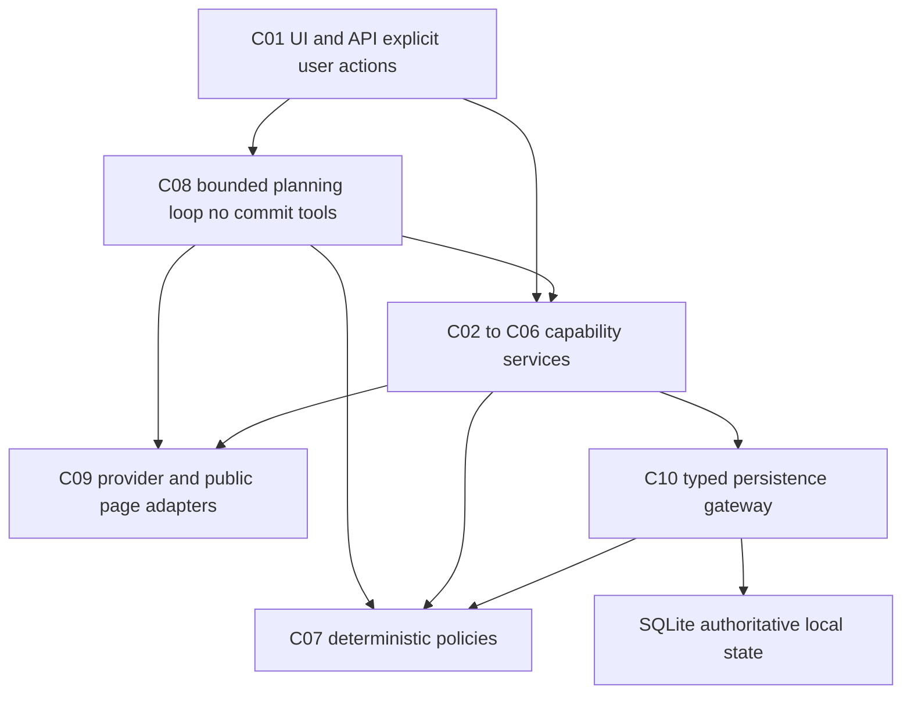

# Component Dependencies and Data Flows

Status: Explicitly approved by the team, recorded at 2026-11-20T19:42:32Z. Documentation only; no implementation or external connection performed. Unit artifacts require separate approval.

## Allowed call/dependency matrix

Rows name callers; columns are callees. “R” is read, “C” compute/coordinated call, “W” authorized write, “A” atomic persistence, “E” bounded external adapter. Blank means no direct call. Each component's transitive capabilities remain subject to service contracts; a call permission does not bypass confirmation.

| Caller | C01 | C02 | C03 | C04 | C05 | C06 | C07 | C08 | C09 | C10 |
| --- | --- | --- | --- | --- | --- | --- | --- | --- | --- | --- |
| C01 | — | C | C | C | C | C | | C | | |
| C02 | | | | | | | C | | | R/W |
| C03 | | | | | | | C | | E | R/W |
| C04 | | | | | | | C | | | R/W |
| C05 | | R | R | R | | | C | | | R/W |
| C06 | | | R | R | | | C | | | R/A |
| C07 | | | | | | | | | | |
| C08 | | R | R | R | R | | C | | E | |
| C09 | | | | | | | | | | |
| C10 | | | | | | | C | | | |

C08's reads of C05 do not invoke its write methods; the tool allowlist is a strict subset of public component methods. C10 depends only on pure C07 checks and internal SQLite adapters, never on C06/C08; thus no transaction-orchestrator dependency cycle. C01 alone builds user-action contexts; application services validate those contexts before C10 writes. C09 adapters never mutate domain persistence. Logical module identity does not imply network boundaries.

## Data-flow overview

Text alternative: user actions enter C01; capability services C02–C06 use pure policies and typed persistence; C08 coordinates only read/compute tools and provider calls; C09 supplies untrusted external data/results; only C10 writes SQLite and its atomic operations recheck deterministic policies. No UI/model-to-SQLite path exists. The APP-to-EXT edge is recipe-service retrieval only; ORCH-to-EXT is provider invocation only.

## Data-flow contracts and trust crossings

| Flow | Input / output | Authority and mutation boundary |
| --- | --- | --- |
| Preferences/inventory edit | Explicit validated manual edit -> current profile/snapshot | Direct save confirms manual edit only; C10 persists/version-changes, never creates cooking implicitly. |
| Recipe source ingestion | Public URL/pasted text -> untrusted parsed metadata -> reviewed eligible record | Treat content as data, never instructions. Public destination/redirect/size/time guards precede fetch. Confirmation and eligibility checks precede reusable save. |
| Planning | Profile, stock snapshot, eligible source recipes -> tool results -> validated PlanDraft + trace | C08 read/compute only. Plan proposal does not reserve or consume stock and is not auto-saved. |
| Shopping | Selected dish requirements + one stock snapshot -> totals/shortages | Compatible arithmetic, inventory credited once, no persistence change. |
| Cooking preview | Recipe selection + servings + corrected actual use -> bound preview/expected stock version | No stock/event commit. Technical preview storage is not completed cooking or confirmation. |
| Cooking confirmation | Explicit user context + preview reference + request ID -> recorded result | C06 validates intent; C10 atomically revalidates and commits stock/event/version/request outcome or rolls back. |
| Undo | Original event + compensation preview + explicit user context -> compensation result | C10 preserves history, checks safe current state and once-only outcome. |
| Remaining meals | Current plan and post-change stock -> validated revision proposal | Same read-only planning loop; separate C05 confirmation required to save. |
| Takeout/leftover annotation | Explicit annotation save -> saved plan annotation | No leftover inventory, raw-stock mutation or repeated original deduction. |

## Key boundaries

- External websites and model output are untrusted; neither source text nor model arguments grant source-use permissions or user confirmation.
- User confirmation is action-specific and bound to the displayed proposal/preview, not a reusable model-authored flag. C01 and application services enforce it; the gateway rechecks authorized command/data integrity in its transaction.
- Stock/event atomicity belongs to C10. No other service has SQL or partial stock-write methods. SQLite remains local; hosted model requests do not carry keys to the UI or permit public DB exposure.
- No transaction spans a remote model/network request. External proposal generation occurs before user confirmation and before short local stock transactions; stale data is rejected at commit.
- Tool traces support future evaluation but are diagnostic only. Redact secrets; no credentials/audit prompt data sent automatically to providers.
- The communication contract is bounded final response. Interrupted transport gives uncertain outcome; request lookup/replay resolves it without a second deduction.

## Future verification responsibilities

Cross-component tests later exercise C01 confirmation to C06/C10 transaction rejection, C08 tool gating to C07, C03 ingestion to eligibility, and C05 shopping/annotations with no stock writes. Hypothesis properties cover quantity/round-trip/invariant/idempotency/stateful behavior per applicable future stages. No such tests or service access occur in this artifact stage.
