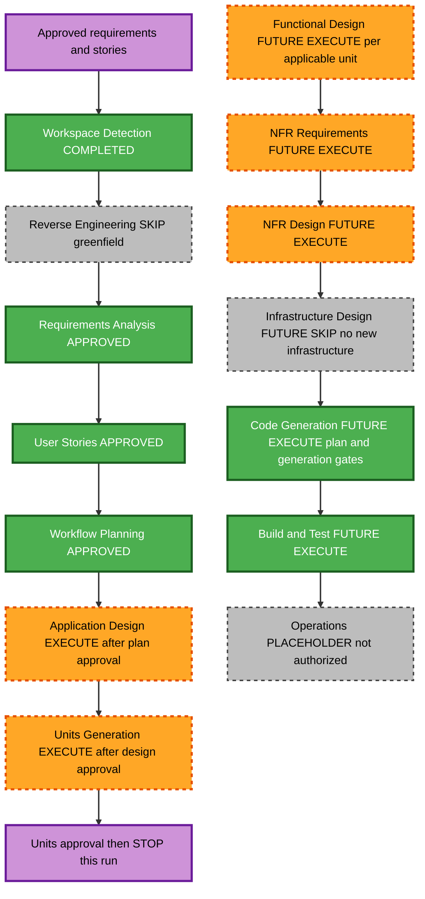

# Cooking Assistant — Execution Plan

Status: Explicitly approved by the team, recorded at 2026-11-20T19:31:11Z. Application Design planning is authorized; design-plan/artifact and unit-plan/artifact gates remain separate. Construction is not authorized.

## 1. Baseline and detailed analysis

Sources: ../requirements/requirements.md, all three clarification rounds, ../user-stories/stories.md (19 stories, 52 scenarios, 33 requirement coverage rows), personas.md (P-01/P-02), and story-generation-plan.md with validated choices B/B/B/A. The current team message explicitly approves both story artifacts. This is a Greenfield documentation-only workspace; no implemented application or package migration exists.

### Change impact

| Area | Assessment |
| --- | --- |
| User-facing | New preferences, recipe access/import, 15-slot planning, shopping arithmetic, plan changes, cooking confirmation/recovery and annotations. |
| Structural | New local UI/backend and logical capabilities need boundaries and orchestration; no architecture is selected by this workflow plan. |
| Data | Recipes/provenance, profile, inventory, meal plans, previews, cooking/undo events need consistent responsibilities and interfaces. Detailed schemas belong to later design. |
| API | Typed UI/backend and allowlisted agent-tool contracts are needed; no endpoints are implemented now. |
| NFR | Exclusions, confirmation, stock integrity, URL/input safety, free-tier failures, performance, keyboard access, agent trace evaluation and full PBT affect design. |
| Infrastructure/operations | Localhost and SQLite baseline; no cloud hosting, public deployment, autoscaling or production monitoring expansion. |

Brownfield transformation analysis, component migration graphs, package update/rollback sequencing and existing build compatibility are N/A: there is no existing application or build manifest. Future code boundaries are determined by Application Design and Units Generation rather than invented package assignments here.

### Risk assessment

Overall delivery risk: High, owing to multiple new capabilities and unverified external data/model feasibility; not a production-critical deployment. Documentation changes have easy rollback; future persistent stock changes require deliberate compensation and are moderate rollback complexity. Testing complexity: Complex, combining deterministic state/arithmetic, agent traces and failure recovery.

| Risk | Mitigation and checkpoint |
| --- | --- |
| Existing recipe sources may not permit use or have complete quantities/servings | During future Construction, verify terms/provenance and count 45 eligible complete distinct records with both cuisine groups/all meal types. Report shortfalls instead of fabricating data or sources. |
| Free model account, quota and function calling unverified | Recheck planned provider/model in future Construction before reliance; report failures, no billing or automatic paid fallback. |
| Duplicate/stale confirmations, negative stock or unsafe undo | Application Design identifies ownership/interfaces; future Functional Design defines state rules and PBT properties; later tests verify atomicity, freshness and idempotency. |
| LLM ignores exclusions, tool results or confirmation boundaries | Preserve deterministic backend validation, explicit allowlisted tools and trace-based 10-scenario evaluation. |
| Cross-capability gaps or drift | Carry all FR/NFR/AC and US identifiers into design and unit maps; preserve shared contracts and explicit review gates. |

## 2. Stage selection and detail

| Stage | Decision | Detail and rationale |
| --- | --- | --- |
| Workspace Detection | COMPLETED | Greenfield determined; no reverse engineering required. |
| Reverse Engineering | SKIP | No application to analyze. May be revisited only if relevant code is introduced and the team requests scope adjustment. |
| Requirements Analysis | COMPLETED AND APPROVED | Comprehensive; functional/non-functional requirements, clarification decisions and measurable acceptance. |
| User Stories | COMPLETED AND APPROVED | Feature groups, two illustrative personas, Given/When/Then scenarios, recovery dependencies, journey and full coverage. |
| Workflow Planning | COMPLETED AND APPROVED | Comprehensive scope, stage choices, risks and gates in this plan. |
| Application Design | EXECUTE AFTER PLAN APPROVAL | Course-mandatory; new components, interfaces, services and dependencies require definition. Comprehensive high-level design, not detailed business implementation. |
| Units Generation | EXECUTE AFTER DESIGN APPROVAL | Course-mandatory; organize approved stories/components into work units and logical modules, including code organization strategy. Comprehensive traceability and dependency analysis; do not assume multiple deployable services. |

All defined artifacts for selected stages are retained; adaptive depth changes detail, not artifact completeness. Generic conditional labels do not remove course deliverables.

## 3. Remaining Inception order, outputs and gates

1. Review this execution plan. Team may request changes or explicitly approve it; no automatic approval.
2. Application Design planning: load its rules and approved context, create inception/plans/application-design-plan.md with checkboxes and relevant embedded questions on boundaries, contracts, orchestration and dependencies. Collect and validate answers; resolve ambiguity; obtain explicit design-plan approval before generating artifacts.
3. Application Design generation: produce inception/application-design/components.md, component-methods.md, services.md, component-dependency.md and consolidated application-design.md. Define responsibilities, high-level method signatures/input-output contracts, service orchestration and dependency/data-flow relationships, keeping detailed business logic for future Functional Design. Validate traceability and applicable extensions; obtain explicit artifact approval before Units Generation.
4. Units Generation planning: create inception/plans/unit-of-work-plan.md. Assess story affinity, dependencies/shared resources, team alignment, deployment/technical differences, domain boundaries and applicable code-organization preferences; justify N/A categories, do not silently omit them. Collect/validate answers, resolve ambiguities and obtain explicit decomposition-plan approval.
5. Units Generation generation: produce inception/application-design/unit-of-work.md, unit-of-work-dependency.md and unit-of-work-story-map.md. Include Greenfield code organization strategy as documentation only. Map every US-01–US-19, carry cross-cutting obligations, validate dependencies and module/unit terminology. A monolithic deployment maps to one whole-application work unit with logical modules; independently deployable units are not assumed.
6. Present unit artifacts for explicit team approval. Once approved, mark Inception complete and STOP. Do not interpret the generic rule's “Approve & Continue to Construction” wording as authorization; this run ends at approved Units Generation.

No additional scope question is needed merely to prepare this workflow plan. Stage-specific design and decomposition choices will be asked in their proper plans rather than preselected here. Named course review responsibilities are not automatic code ownership assignments or permission to approve for absent members.

## 4. Workflow visualization

The graph displays the authorized Inception sequence and a separate, disconnected future lifecycle reference. Green means completed/always required, not automatic approval; the Workflow Planning node is now explicitly approved. Orange denotes selected conditional stages; grey denotes skip/placeholder. No edge connects this run's STOP node to future Construction.

### Text alternative

Current run: Workspace Detection completed; Reverse Engineering skipped for Greenfield; Requirements approved; User Stories approved; Workflow Planning approved; then Application Design planning/approval/generation/approval; then Units Generation planning/approval/generation/approval; then STOP with Inception complete.

Future reference only, not authorized: Functional Design for applicable units; NFR Requirements; NFR Design; Infrastructure Design skipped unless later scope requires it; Code Generation planning and generation with gates; Build and Test; Operations placeholder. A future request and fresh stage prerequisites/approvals are required before any such work.

## 5. Future Construction reference — NOT authorized in this run

| Stage | Future recommendation | Reason and limits |
| --- | --- | --- |
| Functional Design | EXECUTE for units with business logic/data/state | Quantity/unit rules, plan constraints, preview/confirm/undo and schemas need detailed design; identify PBT properties. Assess each final unit; no unit-specific stage is executed now. |
| NFR Requirements | EXECUTE | Retain latency, security inputs, failure handling, accessibility, agent evaluation and Hypothesis selection. No cloud-scale requirement is invented. |
| NFR Design | EXECUTE after NFR Requirements | Incorporate deterministic validation, bounded access, traceability and testability patterns. |
| Infrastructure Design | SKIP under current baseline | Localhost/SQLite environment is already specified; no new infrastructure services or deployment architecture. Reassess if later approved changes require it. |
| Code Generation | EXECUTE if future implementation authorized | Per-unit planning approval before application/test generation; load full applicable rules, pin compatible versions and conduct feasibility checks. |
| Build and Test | EXECUTE after future units complete | Example tests plus Hypothesis, integration, quota/retrieval recovery, accessibility/timing and live agent evaluation; generate all stage-defined build/test instructions then. |
| Operations | PLACEHOLDER / outside scope | No deployment/monitoring execution in this run. |

Each future unit would complete applicable design and generation before moving to the next, followed by integrated Build and Test. Exact units and order must derive from approved unit artifacts, not from this reference. No future feasibility testing, downloads, live model calls, installations, application code, CI or tests are performed here.

## 6. Execution checklist

### Workflow Planning preparation
- [x] Load approved requirements, clarification context, stories and personas.
- [x] Record explicit story/persona approval and close User Stories tracking.
- [x] Assess scope, impacts and risks; mark Greenfield-only exclusions accurately.
- [x] Select all course-required stages and explain future stage recommendations.
- [x] Create and validate workflow visualization with text alternative.
- [x] Document outputs, gates, success criteria and scope stop; update audit/state.
- [x] Receive explicit team execution-plan approval.

### Authorized Inception after this plan is approved
- [x] Prepare Application Design plan and embedded questions.
- [x] Collect/validate design-plan answers and obtain explicit plan approval.
- [x] Generate and validate every Application Design artifact.
- [x] Receive explicit Application Design artifact approval.
- [x] Prepare unit plan and embedded questions.
- [x] Collect/validate unit-plan answers and obtain explicit plan approval.
- [x] Generate and validate all unit artifacts and complete story mapping.
- [x] Receive explicit Units Generation artifact approval.
- [x] Mark Inception complete and STOP without Construction.

## 7. Timeline and success criteria

Lifecycle coverage: three phases described, only Inception authorized. Inception comprises six executed stages including Workspace Detection and the five course stages; Reverse Engineering is skipped. All six executed Inception stages are complete, with required explicit approvals recorded. Construction remains unstarted. The following approval-paced timeline description is the original planning basis, not remaining work. No calendar duration is committed: remaining work is approval-paced with at least four future approvals after this document's approval (design plan, design artifacts, unit plan, unit artifacts, with Inception closeout requiring no additional invented approval). More clarification/review iterations may be needed. No meetings, deadlines or historical decisions are inferred.

Success: retain the already approved requirements and stories; complete all Application Design and unit artifacts in English, with full story/requirement traceability, checked diagrams/text alternatives, explicit team decisions, immediate task/state checkbox updates and append-only audit records. Preserve 45-recipe, 15-slot, 1–10-diner, confirmation, exclusions, no-paid-fallback and evaluation boundaries. Obtain every required approval and stop after approved Units Generation. Runtime functionality and passed tests are not Inception completion criteria.

## 8. Extension compliance and approval gate

Security Baseline and Resiliency Baseline: disabled by explicit answers; skip their rule sets, retain approved security/integrity requirements. PBT-01: N/A now (Functional Design-specific identification); PBT-02: N/A (no round-trip tests); PBT-03: N/A (no invariant tests); PBT-04: N/A (no idempotency tests); PBT-05: N/A (no oracle tests); PBT-06: N/A (no stateful tests); PBT-07: N/A (no generator implementation); PBT-08: N/A (no shrinking/seed/CI execution); PBT-09: N/A (no NFR stage or dependency installation); PBT-10: N/A (no test generation). Carry all applicable full-PBT obligations into future stage plans, with Hypothesis/pytest and complementary example tests. No applicable extension blockers at Workflow Planning; no implementation compliance asserted.

Review execution-plan.md. The team may request changes, request inclusion of skipped stages if justified, or explicitly approve this plan and proceed to Application Design planning. Changing stage inclusion does not override the current prohibition on Construction; expanding that scope requires an explicit later instruction. This plan is explicitly approved; subsequent stage plans and artifacts retain their own review gates.

## Final closeout
All required Inception artifacts explicitly approved; Units Generation and Inception complete as of 2026-11-20T19:58:21Z. No Construction authorized or begun. Submission documentation issues are recorded in inception/submission-readiness-review.md, without changing approved product decisions.
